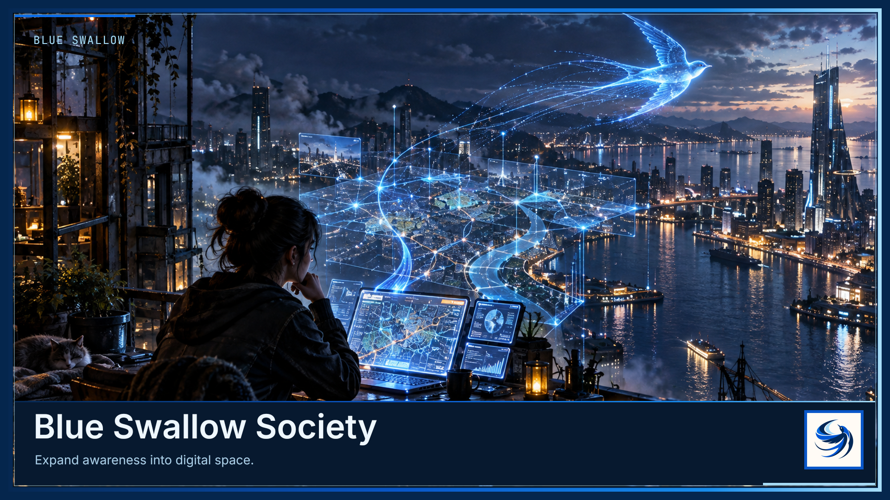

# Blue Swallow Society on Azure Static Web Apps + Cybermap Backend



[Long-Haul Fleet](https://github.com/pH34r-pH/long-haul-fleet) owns private
Society hosting, DNS and deployment controls. Society owns the public app,
Functions, Cybermap runtime and source validation; Wardriver owns the Android
product and device evidence. The [public CI and source handoff](docs/public-ci-handoff.md)
separates source checks from protected deployment and live readback.

The canonical Society origin is **https://blueswallow.ph34r.dev**. The separate
device-ingest gateway is `https://mtls.blueswallow.ph34r.dev:8443`; installed
Android clients retain their own configured origin until a verified migration.
A source or CI result alone does not establish what is currently served.

This repository gives you:

- A **publicly accessible website** on **Azure Static Web Apps**
- **Credential-free public GitHub Actions CI** for the frontend, managed API, and Cybermap runtime
- **Azure Functions** for owner authentication, protected operator APIs, and Cybermap proxy routes
- An **Ubuntu VM API gateway** for the authenticated/idempotent Cybermap ingest service
- A **Cybermap-first geospatial backend design and P0 ingest implementation** using Azure Database for PostgreSQL Flexible Server B1MS + PostGIS
- A clean place to add **local model experiments** later on the VM
- An optional **Azure OpenAI** account, gated by a single Bicep parameter
- Documentation to evolve toward **Microsoft Entra External ID** for customer sign-up/sign-in later

## Current source map

Read [`docs/current-source-map.md`](docs/current-source-map.md) before changing
the companion dashboard, entity workbench, observation ingest, release delivery,
or paper runtime. It separates implemented source from deployment evidence and
physical-device acceptance. The dated implementation delta remains an immutable
historical audit, not current deployment proof.

## Architecture

```text
Browser / Wardriver
  ↓
Azure Static Web App (owner sign-in + private /operator companion)
  ↓
/api/* (managed Azure Functions proxy)
  ↓
VM API gateway on Ubuntu (authenticated Cybermap ingest)
  ↓
Azure Database for PostgreSQL Flexible Server B1MS + PostGIS (target Cybermap store)
```

The browser never calls the VM directly. Owner sessions use Microsoft Entra
authorization-code/PKCE and a short-lived Secure HttpOnly cookie; Functions
validates the owner/scopes before proxying. A source implementation or passing
test does not prove that Azure resources, migrations, identity settings, or
device flows are deployed.

The [Blue Swallow Society System Implementation Delta](./docs/blue-swallow-system-implementation-delta.md) is a dated historical audit with explicit source reconciliations; it is not deployment proof. Current source-state documentation is `docs/static-web-app-functionality.md`; the current implementation map is [`docs/current-source-map.md`](docs/current-source-map.md), with Cybermap route contracts in the Functions and their tests.

---

## Repo Layout

```text
.
├── .github/
│   ├── copilot-instructions.md
│   └── workflows/
│       ├── deploy-static-web-app.yml          # temporary manual recovery path
│       ├── infra-whatif.yml                   # manual what-if (RG scope, OIDC)
│       ├── azure-static-web-apps-wonderful-pond-0623ed81e.yml  # disabled legacy workflow; delete after cutover to blue-swallow-swa
│       └── setup-azure-creds.md
├── api/
│   ├── profile/
│   ├── operator-assets/
│   ├── operator-downloads/
│   ├── operator-shell/
│   └── _private/
│       └── operator/                   # shell/assets; release bytes stay in private Blob storage
├── app/
│   ├── index.html
│   ├── main.js
│   ├── styles.css
│   ├── operator/
│   │   ├── index.html
│   │   ├── loader.css
│   │   └── loader.js
│   └── staticwebapp.config.json
├── docs/
│   ├── architecture.md
│   ├── ai-options-and-budget.md
│   ├── blue-swallow-system-implementation-delta.md
│   ├── cybermap-geospatial-backend.md
│   ├── wardriver-raid-backend-repair-plan.md
│   ├── external-id-setup-checklist.md
│   ├── mosaic-and-murmurs-operating-doctrine.md
│   ├── mosaic-and-murmurs-s0-sensorium-proposal.md
│   ├── mosaic-and-murmurs-morning-brief-proposal.md
│   ├── mosaic-and-murmurs-morning-brief-implementation.md
│   ├── mosaic-and-murmurs-self-pentest-proposal.md
│   ├── mosaic-and-murmurs-source-expansion-research.md
│   ├── microsoft-layoff-risk-radar.md
│   ├── public-official-political-signal-radar.md
│   ├── crypto-paper-trading-strategy-research.md
│   ├── anti-surveillance-style-research.md
│   ├── tzeentch-paper-api-status.md
│   ├── vm-echo-wiring.md              # historical retired-path record
├── config/
│   └── mosaic-murmurs-paper-ledger.json        # paper-only morning brief books/positions
├── infra/
│   ├── main.bicep                  # single entrypoint, composes VM + optional OpenAI
│   ├── custom-domains.bicep        # legacy deployable snapshot; Fleet owns deployment and DNS controls
│   ├── custom-domains-dns.bicep    # legacy unowned-domain snapshot; do not deploy
│   ├── main.parameters.json
│   ├── vm-echo-lab.bicep           # legacy-named VM API gateway + NSG + auto-shutdown
│   └── modules/
│       └── openai.bicep            # optional Azure OpenAI account
├── scripts/
│   ├── local-dev.ps1
│   ├── mosaic-murmurs-morning-brief-collect.py  # public-source morning brief collector
│   ├── print-next-steps.sh
│   ├── wireup-custom-domains.py    # legacy helper; Fleet owns the DNS controls
│   └── wireup-backend-url.sh
└── vm/
    └── cybermap-api/
        ├── README.md                    # P0 authenticated/idempotent ingest contract
        ├── package.json
        ├── src/                         # HTTP, validation, memory/PostgreSQL stores
        ├── test/
        └── db/migrations/               # ordered PostGIS + ingest migrations
```

## What the website does

The root home page is the **Blue Swallow owner sign-in**: a title, session status,
and Microsoft sign-in button. `/api/owner-auth` verifies the exact configured
tenant, client audience, and owner object before issuing a five-minute signed
owner session. The legacy passcode handler remains only as a retired compatibility
route and returns `410` in Entra mode; it is not the current login flow.

The private companion half lives under `/operator`:

- the public route ships only a loader; the shell comes from
  `api/_private/operator/shell.html` after owner-session validation, then the
  loader fetches a fixed allowlist from `/api/operator-assets/{asset}`;
- Travels/history, nearby Cybermap, Entities, World, and Devices have separate
  controllers and teardown paths;
- entity reads require `Owner.Read`, while corrections require the explicit
  Entra `Entities.Write` flow with preview and optimistic revision checks;
- operator data APIs fail closed inside Functions before any VM/private read.

The WiGLE proxy at `/api/wigle` supports:

- `mode=current` → AR current-state path. Reads the device-local WiGLE database/export through `WIGLE_LOCAL_DB_PATH` or `WIGLE_LOCAL_DB_URL`, filters to recent rows (`maxAgeSeconds`, default 45), and orders candidates by signal strength.
- `mode=database` → Godeye/local snapshot path. Reads the same local database/export without AR recency gating.
- `mode=live` → bridge/global fallback. Uses `WIGLE_LIVE_BRIDGE_URL`; direct public WiGLE API lookup is disabled because its search endpoint requires coordinate-bearing URLs.

## Android release delivery

The current release is not stored in this repository or under a public static
path. The authenticated Devices surface reads a private `latest.json` release
manifest and exposes only:

- `/api/operator-downloads/wardriver/apk`
- `/api/operator-downloads/wardriver/metadata`

The manifest must validate as a release build for
`co.blueswallow.wardriver`, bind `sourceTag` to `versionName`, bind the immutable
Blob path to source commit and filename, and carry artifact/signer SHA-256,
source commit, source tag, build run, and publication time. The APK route returns
a five-minute HTTPS read-only Blob SAS or a redirect; it never serves tracked
bytes. Wardriver’s Android settings client reads metadata only and does not
download or install an update automatically. Live manifest/artifact state and
physical installation remain separate acceptance evidence.

The browser does **not** scan Wi-Fi directly or read an Android app-private
SQLite database. Wardriver owns local radio collection, authenticated upload,
and its ARCore/LiteRT camera feature. Society’s browser helpers parse/render
bounded data only; they do not establish physical AR, RF association, or device
behavior.

For a separate local lab bridge, the historical helper remains available:

```bash
python3 scripts/wigle-local-bridge.py --db /path/to/wiglewifi.sqlite --host 127.0.0.1 --port 8787
```

In local development, point the WiGLE endpoint field at `http://127.0.0.1:8787/api/wigle`. In the deployed Static Web App, the production CSP keeps browser calls same-origin; configure `/api/wigle` with a server-reachable `WIGLE_LOCAL_DB_PATH` or `WIGLE_LOCAL_DB_URL` instead of asking the hosted browser to read device-local storage.

## Development and deployment

Pull requests and `main` run [Society public CI](docs/public-ci-handoff.md)
on GitHub-hosted runners without Azure deployment permissions. Fleet owns the
protected source-to-release and hosting paths; a passing public check is not a
deployment or live-readback receipt. [Fleet #630](https://github.com/pH34r-pH/long-haul-fleet/issues/630)
tracks the ownership migration, and [Fleet #1631](https://github.com/pH34r-pH/long-haul-fleet/issues/1631)
tracks paired promotion and recovery.

The legacy public **Deploy Infra + App** workflow remains a manual, main-only
source path with Azure permissions. Its existence does not authorize a run or
prove its credentials are usable. It can affect broad infrastructure and old
domain configuration; consult the protected Fleet recovery plan and
[Society #53](https://github.com/pH34r-pH/blue-swallow-society/issues/53)
before any cutover or retirement. Do not run the old `.net` domain-wiring
helper against Fleet DNS. Public workflow and credential retirement remains
gated on verified private parity and recovery.

The [dated infrastructure specification](docs/azure-resources.md) records the
former public deployment and its old domain assumptions. Consult Fleet's
current hosting records for operational state.

## Notes on security

This scaffold is intentionally simple so you can focus on experiments.

The VM API gateway exposes HTTPS only; the retired echo service is not deployed or routed. Hardening steps already supported:

- `allowedSourceIp` parameter restricts SSH to your CIDR.
- Daily auto-shutdown schedule (DevTestLab) caps idle cost.
- SWA `globalHeaders` set CSP, HSTS, `X-Content-Type-Options`, `X-Frame-Options`, and `Referrer-Policy`.
- Operator access uses the short-lived owner/operator session, not anonymous SWA
  route roles, for `/api/operator-signals`, `/api/cybermap/*`, `/api/osint`,
  `/api/tzeentch`, and release routes. `/api/operator-assets/{asset}` is a fixed
  private allowlist; owner/API scopes are revalidated before backend reads.

Next hardening to consider:

- remove the VM public IP and reach it via private link / VNet integration on the SWA
- swap to Microsoft Entra External ID for customer sign-up/sign-in
- rotate the SWA deployment token quarterly

## AI path

If you want to keep **everything under Azure credits only**, the lowest-risk approach is:

1. **Use local/open models on the VM** for experimentation.
2. **Use Azure OpenAI pay-as-you-go** only for selective calls (`deployOpenAi: true`).
3. Avoid provisioned throughput and fine-tuned hosting early.
